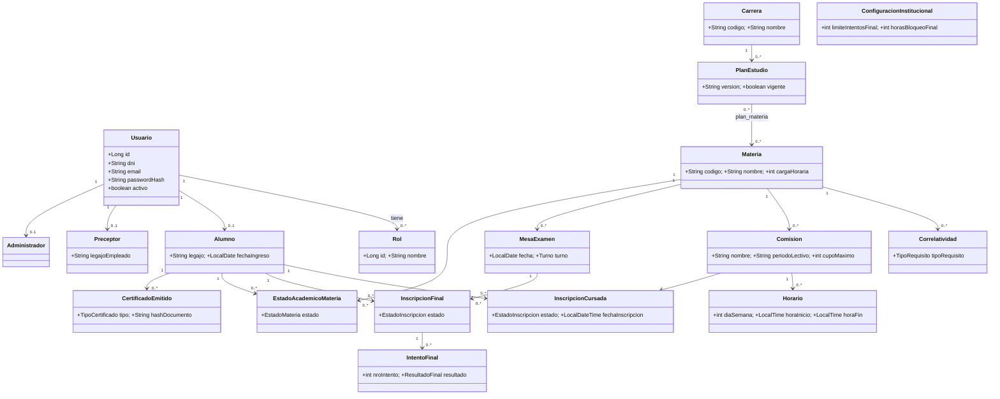
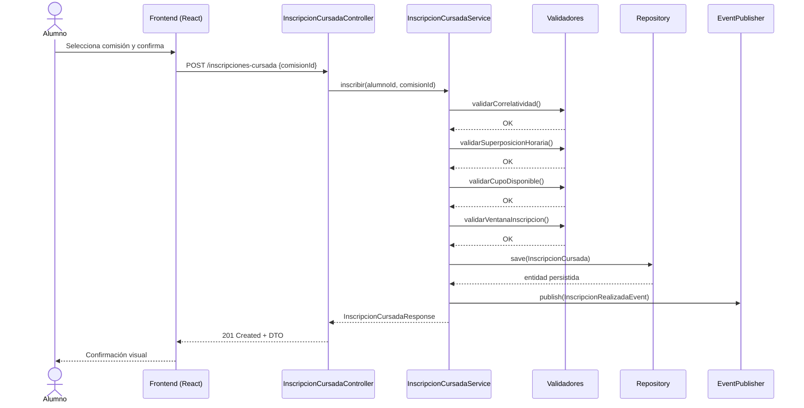
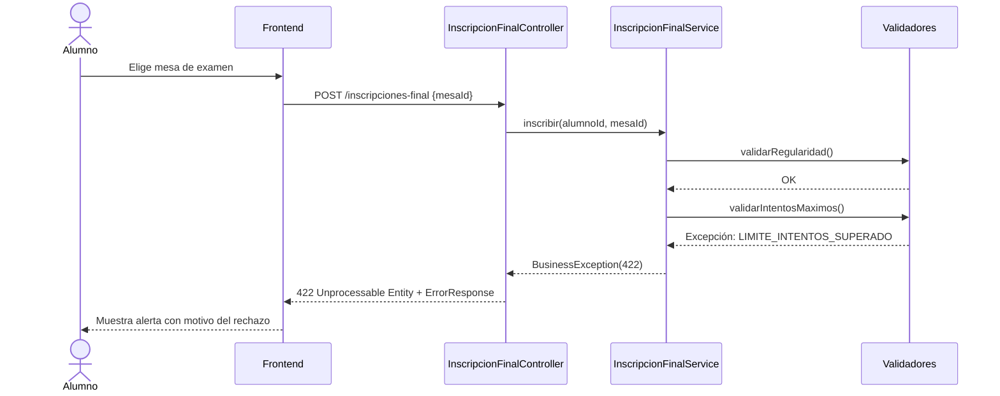
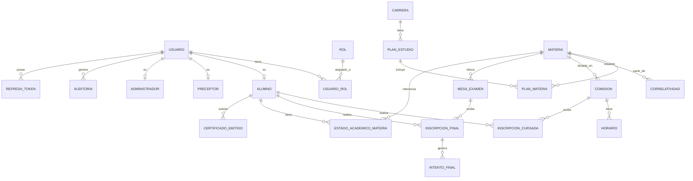
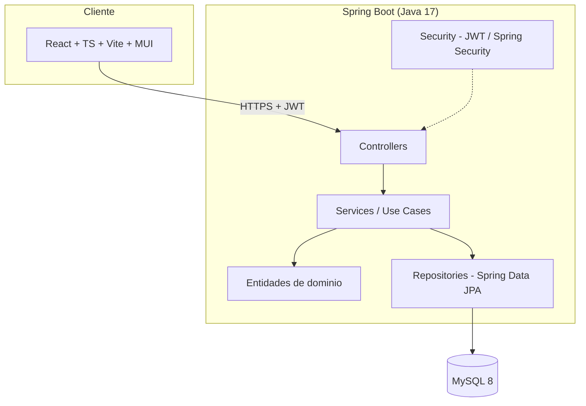

# 09. Diagramas UML

Todos los diagramas están en sintaxis **Mermaid**, renderizables en GitHub, GitLab, VS Code (extensión Mermaid) o cualquier visor compatible.

## 1. Diagrama de casos de uso

```mermaid
graph TB
    Alumno((Alumno))
    Preceptor((Preceptor))
    Administrador((Administrador))

    Alumno --> UC1[Iniciar sesión]
    Alumno --> UC2[Consultar historial académico]
    Alumno --> UC3[Inscribirse a cursada]
    Alumno --> UC4[Inscribirse a final]
    Alumno --> UC5[Modificar inscripción]
    Alumno --> UC6[Descargar certificados]

    Preceptor --> UC1
    Preceptor --> UC7[Buscar alumnos]
    Preceptor --> UC8[Consultar estado académico]
    Preceptor --> UC9[Exportar a Excel]
    Preceptor --> UC6

    Administrador --> UC1
    Administrador --> UC10[Gestionar usuarios]
    Administrador --> UC11[Gestionar oferta académica]
    Administrador --> UC12[Configurar reglas institucionales]
    Administrador --> UC13[Consultar auditoría]
```

## 2. Diagrama de clases (dominio académico, simplificado)

## 3. Diagrama de secuencia — Inscripción a cursada

## 4. Diagrama de secuencia — Inscripción a final (con rechazo por reglas)

## 5. Diagrama Entidad-Relación (resumen)

## 6. Diagrama de arquitectura (capas y despliegue)

## 7. Siguiente etapa

Con toda la documentación técnica y los diagramas completos, el último documento (`10-roadmap-entregables.md`) define las etapas de desarrollo, el backlog técnico y los criterios de aceptación para llevar este diseño a un sistema funcionando.
